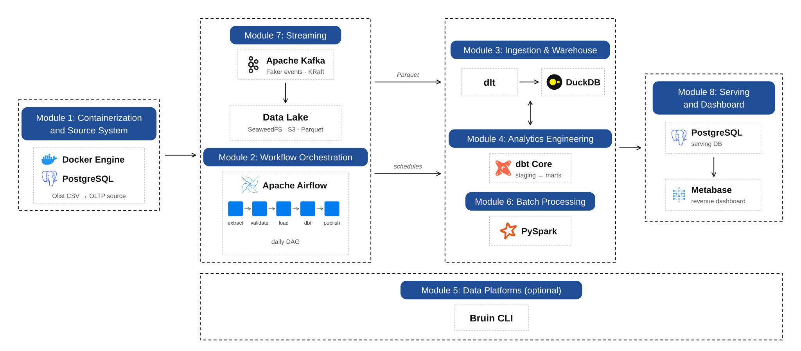
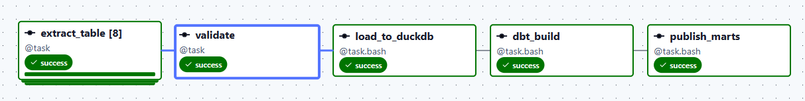
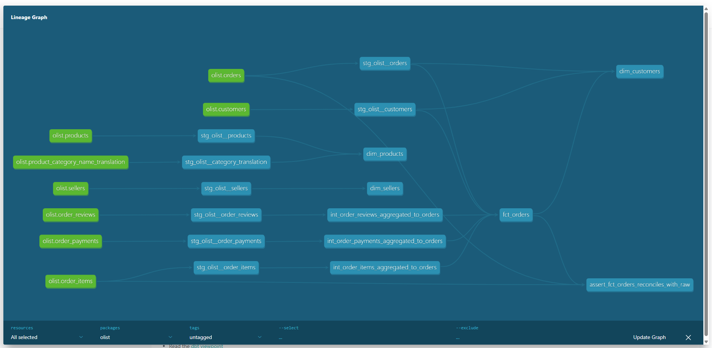
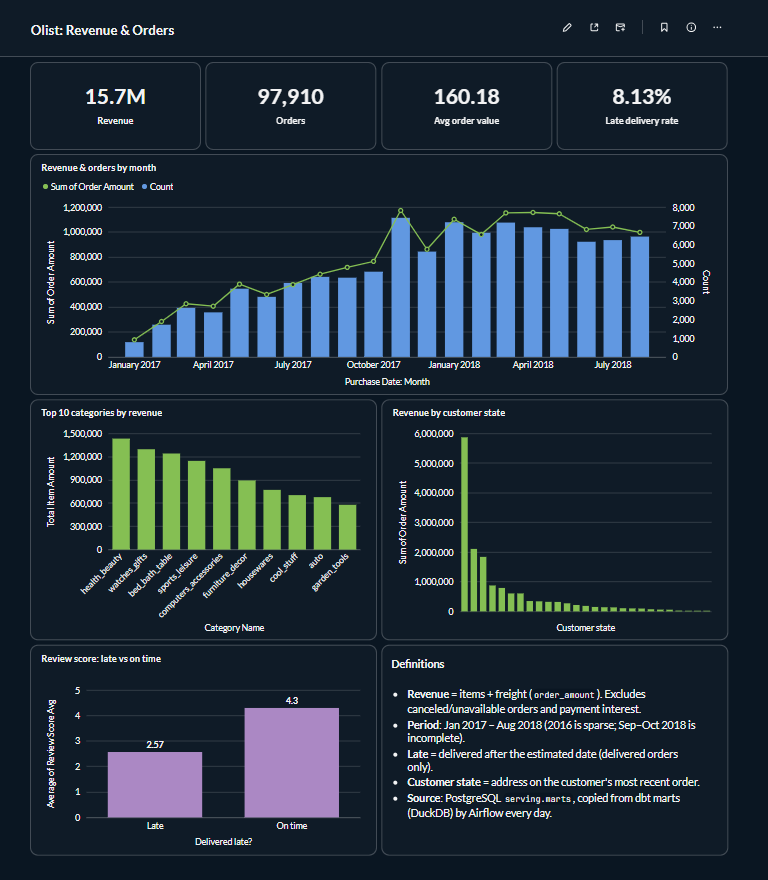

# Olist Commerce Data Platform

**An end-to-end e-commerce data platform, built on a laptop with free, open-source tools.**

Raw orders from a PostgreSQL source flow through a data lake, a DuckDB warehouse and dbt models into a Metabase dashboard, orchestrated daily by Airflow. The design follows a typical modern data platform (lake → warehouse → transformation → BI), with local tools in place of cloud services.

The project covers batch ingestion, a data lake, a warehouse, analytics engineering, batch processing with Spark, streaming with Kafka and a BI dashboard.

## Architecture



**Flow in one example:** an order lands in PostgreSQL → Airflow's daily run copies the tables to Parquet in the lake → dlt merges them into DuckDB → dbt builds `fct_orders` → the mart is copied to a PostgreSQL serving database → Metabase shows revenue per month.

> **Design note: why Metabase reads PostgreSQL, not DuckDB.**
> DuckDB allows only one process to write to a database file. If Metabase kept the warehouse file open, the daily Airflow run (dlt + dbt) would fail with a lock error. Metabase also needs a community plugin and a custom image to read DuckDB.
> So the pipeline adds a small **serving layer**: after dbt finishes, the mart tables are copied to a separate `serving` database, and Metabase connects to it with its built-in PostgreSQL driver. DuckDB stays the place where data is computed; PostgreSQL is the place where data is served. This is a common pattern in production, where BI tools read from a dedicated serving database instead of the warehouse's working files.
> To save memory on a laptop, the `serving` database lives in the same PostgreSQL container as the source system but is fully separated: its own database and its own user, and the extract job only reads the source database. Details: [docs/ARCHITECTURE.md](docs/ARCHITECTURE.md#6-design-decision-serving-layer-for-bi).

Design details: [docs/ARCHITECTURE.md](docs/ARCHITECTURE.md).

## Tech stack

| Layer | Tool |
|---|---|
| Containers | Docker Engine (WSL2) |
| Source (OLTP) | PostgreSQL |
| Orchestration | Apache Airflow 3 |
| Data lake | SeaweedFS (S3 API) |
| Ingestion | dlt |
| Warehouse | DuckDB |
| Transformation | dbt Core + dbt-duckdb |
| Batch processing | PySpark (local mode) |
| Streaming | Apache Kafka (KRaft) + Kafbat UI |
| Serving DB for BI | PostgreSQL (separate `serving` database) |
| Dashboard | Metabase OSS |
| Data platform (optional) | Bruin CLI |

## Modules

| # | Folder | Scope |
|---|---|---|
| M1 | [m1-infra/](m1-infra/) | Docker setup, PostgreSQL as the source system, load the dataset |
| M2 | [m2-orchestration/](m2-orchestration/) | Daily Airflow DAG: PostgreSQL tables → Parquet in the data lake, partitioned by run date |
| M3 | [m3-ingest-warehouse/](m3-ingest-warehouse/) | dlt: data lake → DuckDB, merge (upsert) on primary keys |
| M4 | [m4-dbt/](m4-dbt/) | dbt models, tests, docs, incremental models, snapshots |
| M5 | [m5-bruin/](m5-bruin/) | Optional: rebuild 1–2 models with Bruin and compare with dbt |
| M6 | [m6-spark/](m6-spark/) | PySpark batch job (e.g. customer RFM) |
| M7 | [m7-streaming/](m7-streaming/) | Faker events → Kafka → consumer writes Parquet micro-batches to the data lake → dlt merges them into DuckDB |
| M8 | [m8-dashboard/](m8-dashboard/) | Publish marts to a PostgreSQL serving DB + revenue and order dashboard |

Each module folder has an `images/` folder with screenshots of its output.

## Dataset

[Brazilian E-Commerce Public Dataset by Olist](https://www.kaggle.com/datasets/olistbr/brazilian-ecommerce) (Kaggle): about 100k orders from 2016–2018 across 9 CSV files.
Credit: Olist, published on Kaggle under [CC BY-NC-SA 4.0](https://creativecommons.org/licenses/by-nc-sa/4.0/). This is a non-commercial learning project. Screenshots and figures derived from the dataset (e.g. dashboard images) are shared under the same license.

The CSV files are **not committed** to this repo. To run the project, download them from Kaggle into `data/`.

## Results

| Airflow DAG (daily) | dbt lineage |
|---|---|
|  |  |

Metabase dashboard on the served marts:



More screenshots are in each module's `images/` folder.

## How to run

Tested on Windows 11 + WSL2 (Ubuntu 24.04) with Docker Engine 29 and Docker Compose v5, with WSL limited to 4 GB of RAM. Every service binds to `127.0.0.1` only. Commands below run in a Linux shell from the repo root.

**Prerequisites**
- Linux or WSL2 with Docker Engine and the Compose plugin, plus `openssl` and `curl`.
- The Olist CSV files unzipped into `data/` (see [Dataset](#dataset)). `olist_geolocation_dataset.csv` is not used.

Each secret file has an `.example` next to it. The commands generate random secrets straight into the files instead of typing them (letters and digits only, because Compose treats `$` and `#` specially).

### 1. Shared Docker network (once)

```bash
docker network create de-net
```

### 2. M1: source PostgreSQL

```bash
cd m1-infra
cp .env.example .env
sed -i "s/^POSTGRES_PASSWORD=.*/POSTGRES_PASSWORD=$(openssl rand -hex 16)/" .env
docker compose up -d
docker exec de-postgres psql -U olist -d olist -c "select count(*) from olist.orders;"   # expect 99441
cd ..
```

On the first start (empty volume), the scripts in `m1-infra/init/` create the `olist` schema and load 8 tables from `data/`.

### 3. M8 part 1: serving and Metabase databases (once, before the first DAG run)

The DAG's last task writes to the `serving` database, so its users must exist first.

```bash
cd m8-dashboard
printf 'SERVING_WRITER_PASSWORD=%s\nBI_READER_PASSWORD=%s\nMETABASE_DB_PASSWORD=%s\nMB_ENCRYPTION_SECRET_KEY=%s\nMB_SESSION_SECRET_KEY=%s\n' \
  "$(openssl rand -hex 16)" "$(openssl rand -hex 16)" "$(openssl rand -hex 16)" \
  "$(openssl rand -hex 32)" "$(openssl rand -hex 32)" > .env
set -a; source .env; set +a
docker exec -i de-postgres psql -U olist -d olist -v ON_ERROR_STOP=1 \
  -v serving_writer_pw="$SERVING_WRITER_PASSWORD" -v bi_reader_pw="$BI_READER_PASSWORD" \
  -v metabase_db_pw="$METABASE_DB_PASSWORD" < sql/01_serving_metabase.sql
cd ..
```

Keep `MB_ENCRYPTION_SECRET_KEY` fixed. Metabase encrypts saved connections with it and cannot read them after the key changes.

### 4. M2: data lake + Airflow (runs M3, M4 and M8 publish inside the DAG)

```bash
cd m2-orchestration
LAKE_SECRET=$(openssl rand -hex 16)
cp secrets/s3.json.example secrets/s3.json
sed -i "s/change_me/$LAKE_SECRET/" secrets/s3.json
cp .env.example .env
sed -i \
  -e "s/^AIRFLOW_UID=.*/AIRFLOW_UID=$(id -u)/" \
  -e "s/^AIRFLOW_DB_PASSWORD=.*/AIRFLOW_DB_PASSWORD=$(openssl rand -hex 16)/" \
  -e "s/^AIRFLOW_FERNET_KEY=.*/AIRFLOW_FERNET_KEY=$(openssl rand -base64 32 | tr '+\/' '-_')/" \
  -e "s/^AIRFLOW_JWT_SECRET=.*/AIRFLOW_JWT_SECRET=$(openssl rand -hex 32)/" \
  -e "s/^AIRFLOW_ADMIN_PASSWORD=.*/AIRFLOW_ADMIN_PASSWORD=$(openssl rand -hex 12)/" \
  -e "s/^OLIST_PG_PASSWORD=.*/OLIST_PG_PASSWORD=$(grep '^POSTGRES_PASSWORD=' ../m1-infra/.env | cut -d= -f2)/" \
  -e "s/^LAKE_S3_SECRET=.*/LAKE_S3_SECRET=$LAKE_SECRET/" \
  -e "s/^SERVING_WRITER_PASSWORD=.*/SERVING_WRITER_PASSWORD=$(grep '^SERVING_WRITER_PASSWORD=' ../m8-dashboard/.env | cut -d= -f2)/" \
  .env
docker compose up -d --build        # first build takes a few minutes
curl -s --aws-sigv4 "aws:amz:us-east-1:s3" --user "lakeadmin:$LAKE_SECRET" \
  -X PUT http://127.0.0.1:18333/olist-lake   # create the bucket
grep '^AIRFLOW_ADMIN_PASSWORD=' .env      # password for the Airflow UI
cd ..
```

Open http://127.0.0.1:18080 (user `admin`), unpause `olist_extract_to_lake` and trigger it. The run has 12 tasks: extract ×8 → validate → `load_to_duckdb` (dlt) → `dbt_build` → `publish_marts`, and takes about one minute.

### 5. M8 part 2: Metabase dashboard

Airflow and Metabase together do not fit in 4 GB, so stop Airflow first:

```bash
(cd m2-orchestration && docker compose down)
cd m8-dashboard && docker compose up -d
docker compose logs -f metabase | grep -m1 -E "Initialization (COMPLETE|FAILED)"   # 1–2 minutes
```

Open http://127.0.0.1:13000, create a local admin account, then add a database: PostgreSQL, host `de-postgres`, port `5432`, database `serving`, user `bi_reader`, password `BI_READER_PASSWORD` from `m8-dashboard/.env`, schema `marts`. The dashboard itself lives in Metabase's own database and is not exported to this repo.

### Run M3 / M4 by hand (optional)

```bash
cd m3-ingest-warehouse
python3 -m venv .venv && source .venv/bin/activate && pip install -r requirements.txt
cp .dlt/secrets.toml.example .dlt/secrets.toml   # set aws_secret_access_key = LAKE_S3_SECRET
python lake_to_duckdb.py --dt <partition date, YYYY-MM-DD>
deactivate && cd ../m4-dbt
python3 -m venv .venv && source .venv/bin/activate && pip install -r requirements.txt
DO_NOT_TRACK=1 dbt build --profiles-dir .
```

Do not open the DuckDB file by hand while the DAG is running: DuckDB allows only one writer.

### Stop

```bash
(cd m8-dashboard && docker compose down); (cd m2-orchestration && docker compose down); (cd m1-infra && docker compose down)
```

`docker compose down` keeps the data volumes. Add `-v` to delete them.

## Repository structure

```
de-ecommerce-pipeline/
├── data/              # Olist CSVs (download yourself, not committed)
├── docs/              # Architecture notes and diagrams
├── m1-infra/ … m8-dashboard/   # One folder per module
└── LICENSE            # MIT (code)
```

## License

- Code: [MIT](LICENSE) © 2026 Vo Quoc Minh
- Dataset: Olist, [CC BY-NC-SA 4.0](https://creativecommons.org/licenses/by-nc-sa/4.0/) (not included in this repo)
- Tool logos in the architecture diagram: [Simple Icons](https://simpleicons.org) (CC0). Trademarks belong to their owners.
