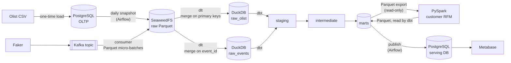

# Architecture

This page describes how data moves through the pipeline and why each tool was chosen.
For a short overview, see the [README](../README.md).

## 1. Data flow

| Step | From → To | Tool | What happens |
|---|---|---|---|
| 1 | CSV → PostgreSQL | SQL (`COPY`) | Load 8 Olist tables once, on the first container start. PostgreSQL acts as the "production" source system. |
| 2 | PostgreSQL → data lake | Airflow DAG | Every daily run copies each full table to one Parquet file in the S3 bucket, under a `dt=<run date>` partition, then checks that row counts match. |
| 3 | Data lake → warehouse | dlt | Load the run's partition into DuckDB `raw_olist` and merge (upsert) on primary keys, so re-runs do not create duplicates. |
| 4 | Warehouse → marts | dbt | Clean and model the data: `staging` (rename, cast, fix time zones), `intermediate` (aggregate items, payments and reviews to one row per order), `marts` (facts and dimensions). Includes tests, docs, an incremental model and a snapshot. |
| 5 | Warehouse ↔ Spark | PySpark, dbt | `m6-spark/rfm_job.py` exports `fct_orders` from DuckDB to Parquet over a read-only connection, then Spark (local mode) computes recency, frequency and monetary value per customer, scores them and assigns one of six segments, and writes the result as Parquet. dbt reads that file as a source, builds `customer_rfm` and checks that its customers and revenue match `fct_orders`. The job runs by hand, not in the daily DAG. |
| 6 | Events → data lake → warehouse | Kafka + consumer, dlt | Faker produces about 5 order events per second with real Olist customer and product IDs, and stops after N minutes. A consumer writes the events to the lake as Parquet micro-batches (every 60 seconds or 5,000 events) and commits Kafka offsets only after the files are written. dlt then reads only the files added since its last run and merges them into DuckDB `raw_events` on `event_id`, so events read twice are not duplicated. dbt cleans them in `stg_events__order_events`. The event load runs by hand, not in the daily DAG. |
| 7 | Marts → serving DB | Airflow task | After dbt finishes, copy the mart tables from DuckDB to a separate PostgreSQL `serving` database. `customer_rfm` is copied by hand with `publish_marts.py --tables customer_rfm`. See [section 6](#6-design-decision-serving-layer-for-bi). |
| 8 | Serving DB → dashboard | Metabase | Revenue and order dashboard, and an RFM segment dashboard, on top of the served marts. |

## 2. Data layers

| Layer | Location | Example | Purpose |
|---|---|---|---|
| Source | PostgreSQL `olist` schema | `olist.orders`, `olist.order_items` | Simulates the application database |
| Lake | SeaweedFS bucket `olist-lake` | `olist/orders/dt=2026-10-08/orders.parquet` | Raw files, one partition per run date |
| Lake (events) | SeaweedFS bucket `olist-lake` | `events/order_events/dt=2026-10-19/batch-<time>-<id>.parquet` | One file per consumer flush, partitioned by event date |
| Raw | DuckDB `raw_olist` | `raw_olist.orders` | Data as loaded by dlt, no business logic |
| Raw (events) | DuckDB `raw_events` | `raw_events.order_events` | Events as loaded by dlt, one row per `event_id` |
| Staging | DuckDB `analytics_staging` (views) | `stg_olist__orders`, `stg_events__order_events` | One model per source table: types, names, light cleaning |
| Intermediate | DuckDB `analytics_intermediate` (views) | `int_order_items_aggregated_to_orders` | Aggregate child tables to one row per order, to avoid fan-out in joins |
| Marts | DuckDB `analytics_marts` (tables) | `fct_orders`, `fct_order_items`, `dim_customers`, `customer_rfm` | Final business tables |
| Spark files | `m6-spark/data/` (local Parquet, not committed) | `in/fct_orders.parquet`, `out/customer_rfm/` | Input and output of the Spark job |
| Snapshots | DuckDB `analytics_snapshots` | `snp_olist__sellers` | History of seller changes (SCD type 2) |
| Serving | PostgreSQL `serving` database, `marts` schema | `marts.fct_orders` (copy) | Read-only copy of the marts for BI tools |

## 3. Tool choices

| Need | Choice | Why |
|---|---|---|
| Containers | Docker Engine in WSL2 | Free for commercial use. Docker Desktop needs a paid license in large companies. |
| Orchestration | Airflow 3 (LocalExecutor) | Most common orchestrator in job postings. LocalExecutor avoids running Celery and Redis on a laptop. |
| Data lake | SeaweedFS | S3-compatible and Apache 2.0. MinIO's community repo was archived in 2026. |
| Ingestion | dlt | Handles schema inference and merge loads in a few lines of Python. |
| Warehouse | DuckDB | Runs in-process with no server and is fast enough for about 100k orders. Replaces BigQuery at $0. |
| Transformation | dbt Core | Industry standard for SQL modeling, testing and documentation. |
| Batch processing | PySpark in local mode, OpenJDK 21 | The most common engine for large batch jobs; local mode runs it in one process. Spark cannot read a DuckDB file, so the job exchanges Parquet files with the warehouse instead of holding a connection. OpenJDK from the Ubuntu packages is free for commercial use, unlike Oracle JDK. |
| Streaming | Apache Kafka (KRaft) | KRaft removes ZooKeeper, so there is one less container. Uses only the Apache images, not Confluent's commercial ones. |
| Serving DB | PostgreSQL (`serving` database) | Avoids the DuckDB single-writer lock and lets Metabase use its built-in driver. See section 6. |
| Dashboard | Metabase OSS | Free and quick to set up. Uses the official image and the built-in PostgreSQL driver. |

## 4. Local runtime

Everything runs on one laptop: the servers in Docker, the Spark job and the Kafka clients as Python processes in WSL. Every service is bound to `127.0.0.1`, and none is set to restart automatically.

| Service | Host port |
|---|---|
| PostgreSQL | 15432 |
| Airflow UI | 18080 |
| Metabase | 13000 |
| Kafka | 19092 |
| Kafbat UI | 18081 |
| SeaweedFS S3 | 18333 |
| Spark UI (only while a job runs) | 14040 |

The ports are offset from the defaults to avoid clashes with other local services.
Each module that runs services has its own Compose file (`m1-infra`, `m2-orchestration`, `m7-streaming`, `m8-dashboard`), joined by a shared external network `de-net`, so each module starts only what it needs. The total resource budget for WSL2 is 4 GB of RAM and 4 CPUs.

## 5. Known risks

- **DuckDB has a single writer.** Only one process can hold a write connection to the `.duckdb` file. Inside the Airflow DAG, dlt, dbt and the publish task run one after another, so they never compete. For BI, see the decision in section 6. The Kafka consumer never opens DuckDB: it writes Parquet files to the lake, and dlt loads them like the batch data. The event load (`events_to_duckdb.py`) runs by hand, so it must not run while the DAG is running.
- **At-least-once delivery.** If the consumer stops after writing a file but before committing offsets, the same events are written again. The merge on `event_id` keeps one row per event, and a dbt `unique` test checks it.
- **Small files.** At about 5 events per second, each flush writes about 300 events. This is fine for learning; a real setup would flush less often or compact the files.
- **Memory.** Airflow, Kafka and Spark together can go over 4 GB. Start only the services of the current module.
- **Spark output is not rebuilt by the DAG.** dbt only sees the Parquet file, not that Spark computed it from `fct_orders`. After the marts change, run `rfm_job.py` again, then `dbt build --select customer_rfm`. The model is disabled for the Airflow target, because the Airflow container has no Spark output.

## 6. Design decision: serving layer for BI

**Context.** Metabase must read the marts, but the marts live in a DuckDB file that the Airflow DAG writes every day.

**Options considered.**

| | A. Metabase reads the DuckDB file | B. Copy the marts to PostgreSQL (chosen) |
|---|---|---|
| File lock | Metabase holding the file open blocks the daily load (dlt) and dbt. A read-only connection does not help, because a writer cannot open the file while a reader holds it. | No conflict. Metabase never touches the DuckDB file. |
| Driver and image | DuckDB is not built into Metabase. It needs a community plugin, and the plugin does not run on the official Alpine-based image, so a custom glibc image is required. The plugin also bundles its own DuckDB version, which can lag behind the one that writes the file. | Official Metabase image with the built-in PostgreSQL driver. |
| Memory on a 4 GB laptop | Airflow must be up whenever the dashboard is used. | Building dashboards needs only PostgreSQL and Metabase. Airflow can be stopped. |
| Extra work | None | One extra Airflow task that copies a few small tables (about 100k rows each) after dbt. |

**Decision.** Option B. DuckDB is where data is computed; PostgreSQL is where data is served. This separation of a working warehouse and a serving database is common in production setups.

**How it is isolated.** To save memory, the `serving` database runs in the same PostgreSQL container as the source system (M1), but:
- it is a separate database with its own user, which can write only to `serving`;
- the extract job (M2) reads only the source database, so served data never flows back into the pipeline;
- Metabase stores its own settings in another separate database, not in the default embedded H2 file, which can be corrupted if the container stops abruptly.

In a real deployment, the serving database would run on its own server. Removing M8 means dropping two databases; the source data is not affected.
