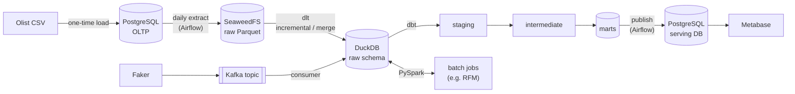

# Architecture

This page describes how data moves through the pipeline and why each tool was chosen.
For a short overview, see the [README](../README.md).

## 1. Data flow

| Step | From → To | Tool | What happens |
|---|---|---|---|
| 1 | CSV → PostgreSQL | SQL / Python | Load the Olist tables once. PostgreSQL acts as the "production" source system. |
| 2 | PostgreSQL → data lake | Airflow DAG | Extract each table by day and write Parquet files to the S3 bucket. Replaying the dataset day by day simulates a daily load. |
| 3 | Data lake → warehouse | dlt | Load Parquet into DuckDB `raw` tables with incremental / merge loads, so re-runs do not create duplicates. |
| 4 | Warehouse → marts | dbt | Clean and model the data: `staging` (rename, cast), `intermediate` (joins), `marts` (facts and dimensions). Includes tests, docs and snapshots. |
| 5 | Warehouse ↔ Spark | PySpark | Batch jobs that read from and write back to the warehouse, e.g. customer RFM segmentation. |
| 6 | Events → warehouse | Kafka + consumer | Faker produces about 5 order events per second. A consumer writes them to DuckDB. The producer stops after N minutes. |
| 7 | Marts → serving DB | Airflow task | After dbt finishes, copy the mart tables from DuckDB to a separate PostgreSQL `serving` database. See [section 6](#6-design-decision-serving-layer-for-bi). |
| 8 | Serving DB → dashboard | Metabase | Revenue and order dashboards on top of the served marts. |

## 2. Data layers

| Layer | Location | Example | Purpose |
|---|---|---|---|
| Source | PostgreSQL | `orders`, `order_items` | Simulates the application database |
| Lake | SeaweedFS bucket | `orders/dt=2017-01-05/*.parquet` | Immutable raw files, partitioned by date |
| Raw | DuckDB `raw` schema | `raw.orders` | Data as loaded, no business logic |
| Staging | DuckDB `staging` | `stg_orders` | One model per source table: types, names, light cleaning |
| Intermediate | DuckDB `intermediate` | `int_order_items_enriched` | Joins and reusable logic |
| Marts | DuckDB `marts` | `fct_orders`, `dim_customers` | Final business tables |
| Serving | PostgreSQL `serving` database | `fct_orders` (copy) | Read-only copy of the marts for BI tools |

## 3. Tool choices

| Need | Choice | Why |
|---|---|---|
| Containers | Docker Engine in WSL2 | Free for commercial use. Docker Desktop needs a paid license in large companies. |
| Orchestration | Airflow 3 (LocalExecutor) | Most common orchestrator in job postings. LocalExecutor avoids running Celery and Redis on a laptop. |
| Data lake | SeaweedFS | S3-compatible and Apache 2.0. MinIO's community repo was archived in 2026. |
| Ingestion | dlt | Handles schema inference and incremental loads in a few lines of Python. |
| Warehouse | DuckDB | Runs in-process with no server and is fast enough for about 100k orders. Replaces BigQuery at $0. |
| Transformation | dbt Core | Industry standard for SQL modeling, testing and documentation. |
| Streaming | Apache Kafka (KRaft) | KRaft removes ZooKeeper, so there is one less container. Uses only the Apache images, not Confluent's commercial ones. |
| Serving DB | PostgreSQL (`serving` database) | Avoids the DuckDB single-writer lock and lets Metabase use its built-in driver. See section 6. |
| Dashboard | Metabase OSS | Free and quick to set up. Uses the official image and the built-in PostgreSQL driver. |

## 4. Local runtime

All services run in Docker on one laptop. Every service is bound to `127.0.0.1`, and none is set to restart automatically.

| Service | Host port |
|---|---|
| PostgreSQL | 15432 |
| Airflow UI | 18080 |
| Metabase | 13000 |
| Kafka | 19092 |
| Kafbat UI | 18081 |
| SeaweedFS S3 | 18333 |

The ports are offset from the defaults to avoid clashes with other local services.
Services are grouped with Docker Compose profiles, so each module starts only what it needs. The total resource budget for WSL2 is 4 GB of RAM and 4 CPUs.

## 5. Known risks

- **DuckDB has a single writer.** Only one process can hold a write connection to the `.duckdb` file. Inside the Airflow DAG, dlt, dbt and the publish task run one after another, so they never compete. For BI, see the decision in section 6. For the Kafka consumer (M7), the options are still to be evaluated, for example writing to a separate file.
- **Memory.** Airflow, Kafka and Spark together can go over 4 GB. Start only the services of the current module.

## 6. Design decision: serving layer for BI

**Context.** Metabase must read the marts, but the marts live in a DuckDB file that the Airflow DAG writes every day.

**Options considered.**

| | A. Metabase reads the DuckDB file | B. Copy the marts to PostgreSQL (chosen) |
|---|---|---|
| File lock | Metabase holding the file open blocks the daily load (dlt) and dbt. A read-only connection does not help, because a writer cannot open the file while a reader holds it. | No conflict. Metabase never touches the DuckDB file. |
| Driver and image | DuckDB is not built into Metabase. It needs a community plugin, and the plugin does not run on the official Alpine-based image, so a custom glibc image is required. The plugin also bundles its own DuckDB version, which can lag behind the one that writes the file. | Official Metabase image with the built-in PostgreSQL driver. |
| Memory on a 4 GB laptop | Airflow must be up whenever the dashboard is used. | Building dashboards needs only PostgreSQL and Metabase. Airflow can be stopped. |
| Extra work | None | One extra Airflow task that copies a few small tables (about 100k rows each) after dbt. |

**Decision.** Option B. DuckDB is where data is computed; PostgreSQL is where data is served. This separation of a working warehouse and a serving database is common in production setups.

**How it is isolated.** To save memory, the `serving` database runs in the same PostgreSQL container as the source system (M1), but:
- it is a separate database with its own user, which can write only to `serving`;
- the extract job (M2) reads only the source database, so served data never flows back into the pipeline;
- Metabase stores its own settings in another separate database, not in the default embedded H2 file, which can be corrupted if the container stops abruptly.

In a real deployment, the serving database would run on its own server. Removing M8 means dropping two databases; the source data is not affected.
